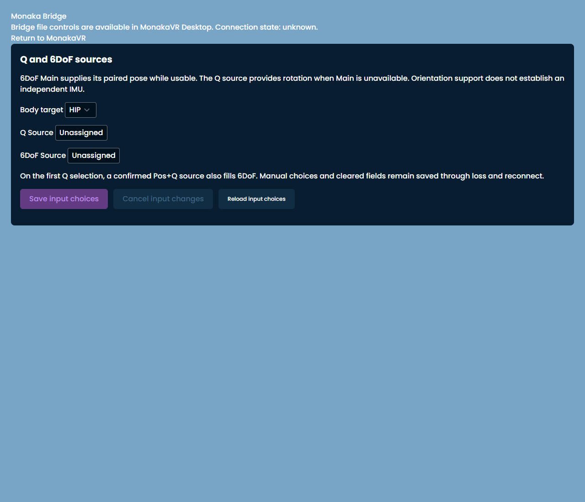
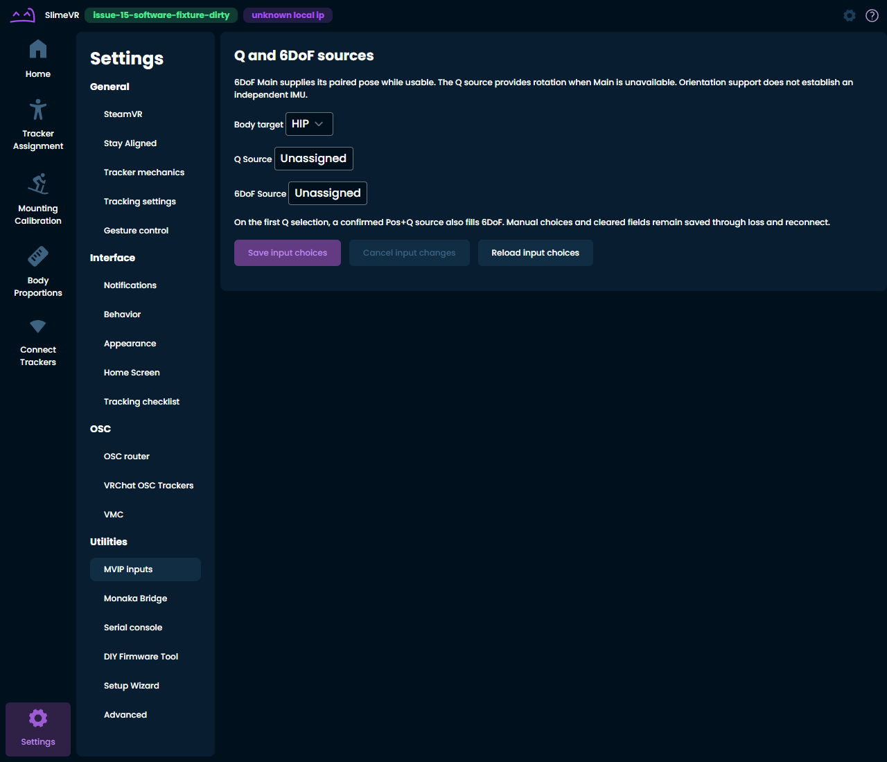
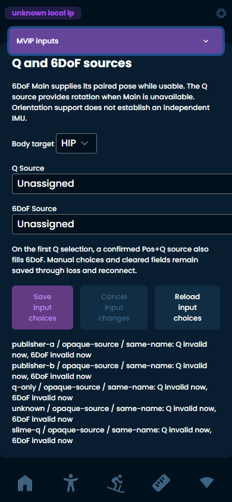
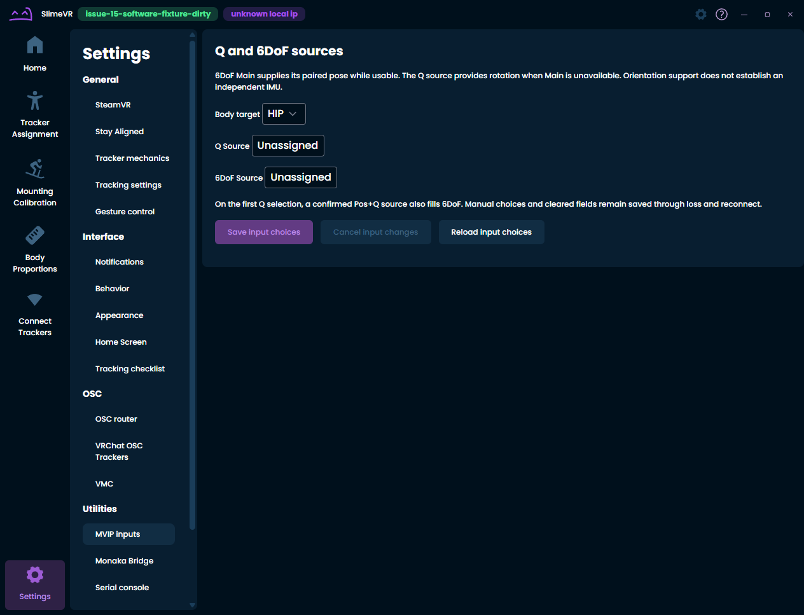

# Issue #15 Stage 1 検証台帳

Stage 1では、既存のConsumer-owned Q/6DoF割当UIを通常設定へ独立させた。
製品の実装差分は6ファイル。既存UI・Controller・Socket・Core保存経路を再利用した。
独立実装のProducer相互運用試験は未実施であり、アーキテクチャ受入全体は未達。
Draftの維持、独立レビュー、ユーザー承認が必要。mergeは実施していない。

## 固定基準と責務

| 項目        | 値                                                                                                  |
| ----------- | --------------------------------------------------------------------------------------------------- |
| 対象        | [Issue #15](https://github.com/MonakaVR/MonakaVR/issues/15)、親#2、後続#16                          |
| 基準dev     | `f02f43e935f9ec42387b38a71483583ef8bc2837`                                                          |
| 専用branch  | `feature/issue-15-independent-mvip-settings`                                                        |
| 実装commit  | `3dbfd0089c59c910af89ef228ebd0fa2d46d655a`                                                          |
| Draft PR    | [#18](https://github.com/MonakaVR/MonakaVR/pull/18)                                                 |
| Phase 0参照 | [PR #17](https://github.com/MonakaVR/MonakaVR/pull/17) / `7147a2d4c29a378f60353a1d5a0b4d5c1ba31ea8` |
| 調査条件    | `AGENTS.md`、Task5、upstream handoff、Phase 0台帳、Issue #2/#15/#16の現行方針を確認                 |

Phase 0は参照のみでありmergeしていない。dev/mainへのpush・merge、検証専用PRのmerge、
CI/Spotlessの抑制・skip追加・閾値緩和は行っていない。

## Before / After

| Before                                                            | After                                                             |
| ----------------------------------------------------------------- | ----------------------------------------------------------------- |
| `/bridge`がQ/6DoF UIを子として表示。通常設定Layout/Providerの外側 | `/settings/monaka-input`を通常設定の子routeへ追加                 |
| Bridge画面へ行くことが入力割当への導線                            | Settings Sidebarとモバイル設定セレクタにMVIP入力を追加            |
| WebではBridge非対応の案内とConsumer UIが同居                      | Consumer UIをBridge APIなしで表示。旧Bridge画面から埋め込みを解除 |

Beforeは既存統合候補`3840a4cc3729cc60e7f33fe5f049d3596e2f8a11`から採取した。
`git diff 3840a4cc..f02f43e9 -- gui`が空で、固定devとGUIソースが同一であることを確認した。
画面のCore応答は合成GUI RPC fixture。実Producerや実機の画面ではない。

Before（Edge、Webの旧Bridge画面、入力なし）:



After（Edge、通常設定、入力なし）:



After（Edge、390×844、合成catalog）:



After（隔離Electron renderer、入力なし）:



既存コンポーネントの英語本文、Body/Q/6DoF配置、選択・保存UIは変更していない。
モバイルの既存コンポーネント自体のレイアウト再設計も行っていない。

## 変更ファイル

| ファイル                                                     | 対応                                                                                    |
| ------------------------------------------------------------ | --------------------------------------------------------------------------------------- |
| `gui/src/App.tsx`                                            | 通常Provider群とSettingsLayout内に既存コンポーネントをroute登録                         |
| `gui/src/components/settings/SettingsSidebar.tsx`            | デスクトップ設定リンク                                                                  |
| `gui/src/components/settings/SettingsLayout.tsx`             | モバイル設定リンク                                                                      |
| `gui/public/i18n/en/translation.ftl`                         | `MVIP inputs`                                                                           |
| `gui/public/i18n/ja/translation.ftl`                         | `MVIP入力`                                                                              |
| `gui/src/components/settings/pages/MonakaBridgeSettings.tsx` | 入力UIのimport、埋め込み、内部fixture用`inputControls` propを除去。Bridge管理処理は維持 |
| `gui/tests/bridge-smoke/main.tsx`, `native.tsx`              | 上記内部propを呼出しから除去                                                            |
| `gui/tests/monaka-input-route/`                              | 実Appを使うEdge 6件、隔離Electron 1件、公開GUI RPC fixture、実行設定・説明              |
| `docs/validation/issue-15-stage1-20261021.md`, `.json`       | 本台帳と機械可読結果                                                                    |
| `docs/validation/issue-15-stage1/*.png`                      | Before/After 4枚                                                                        |

## Core保存経路と無変更範囲

以下は固定devと実装commitで同一Git blob。保存RPC、単一Writer、世代照合、
トランザクション、restart待ちの仕様を変更していない。

| ファイル                                                                       | Git blob SHA-1                             |
| ------------------------------------------------------------------------------ | ------------------------------------------ |
| `gui/src/components/settings/pages/MonakaInputSettings.tsx`                    | `4a538b7235c841821d87aa1ef794d7cac80e6497` |
| `gui/src/monaka-input/controller.ts`                                           | `8b8e48cb244e7ca535e2ce570822bb571a8965d5` |
| `gui/src/monaka-input/socket.ts`                                               | `f2d15cde39cce072b94b22aa2a2545324c9d8a2c` |
| `server/core/src/main/java/dev/monaka/tracking/MonakaInputConfigurationApi.kt` | `2b4794755b57e282f5c2678475bcfba9fe8ffe9a` |
| `server/core/src/main/java/dev/monaka/tracking/MonakaConfiguration.kt`         | `36fcc61bbca53668a77ab7340f6cb705c618e7bd` |

`server/`、`solarxr-protocol`、`gui/electron/`、Bridge service/IPC/tray/validator/writer、
通常TrackerAssignment/SingleTrackerBodyAssignmentMenu/SolarXR AssignTrackerRequest、
Protocol kit、Fusion/IKと既存Workflowには差分がない。新しいwire codecもない。

## ローカル検証（Windows、2026-10-21）

| 検証                                               | 結果                                                   | 範囲                                                                            |
| -------------------------------------------------- | ------------------------------------------------------ | ------------------------------------------------------------------------------- |
| JDK                                                | 17.0.20.1 Microsoft HotSpot（build `17.0.20.1+1-LTS`） | `JAVA_HOME`を明示                                                               |
| 全Spotless                                         | PASS                                                   | root `spotlessCheck`、自動整形の追加実行なし                                    |
| Core全試験                                         | PASS 2015 / fail 0 / skip 0                            | `:server:core:test`                                                             |
| Desktop全試験                                      | PASS 153 / fail 0 / skip 0                             | `:server:desktop:test`                                                          |
| MTP process E2E                                    | PASS 11 / fail 0                                       | `:server:desktop:mtpProcessE2E`、実受信/Core/IK/Protobuf出力と合成外部publisher |
| GUI lint                                           | PASS                                                   | `pnpm --dir gui run lint`、tsc/eslint/Prettier                                  |
| GUI build                                          | PASS                                                   | `pnpm --dir gui run build`、Electron main/preload/rendererのbuild               |
| 新規route TypeScript / Prettier                    | PASS                                                   | 専用tsconfig、新規ts/cjs、変更した旧fixture                                     |
| 旧Bridge smoke TypeScript                          | PASS                                                   | `bridge-smoke.tsconfig.json`                                                    |
| 新規Edge画面試験                                   | PASS 6 / fail 0 / skip 0                               | 実App/Provider/Layout、fixture GUI RPC                                          |
| 新規Electron smoke                                 | PASS 1 / fail 0 / skip 0                               | 隔離main/preload、実renderer、Bridge IPC呼出し0                                 |
| 入力選択 / Bridge Controller / IPC / 日本語化 Node | PASS 24 / fail 0 / skip 0                              | 既存4ファイルを明示実行、入力選択7件を含む                                      |
| 診断GUI TypeScript / Node / Edge                   | PASS / 40 / 17                                         | `monaka-status`専用suite                                                        |
| モード TypeScript / Node / Edge                    | PASS / 10 / 3                                          | `monaka-mode`専用suite                                                          |
| Bridgeソフトウェア画面                             | PASS 2 / fail 0 / skip 0                               | `controls.spec.ts`、既存mock API fixture                                        |
| Bridge native validator / service全試験            | NOT RUN                                                | この作業ではproducer所有CLIを実行していない。24件に含めない                     |
| Before/After                                       | 採取・目視確認済み                                     | 上記4枚                                                                         |

JVM実行コマンド:

```powershell
$env:JAVA_HOME='C:\Program Files\Microsoft\jdk-17.0.20.101-hotspot'
.\gradlew.bat spotlessCheck :server:core:test :server:desktop:test :server:desktop:shadowJar :server:desktop:mtpProcessE2E --no-daemon --console=plain
```

MTP結果receipt: `server/desktop/build/mtp-process-e2e/cf1e61c9-8e11-43d6-9b58-a34d9a0538ce/result.json`。
receipt SHA-256: `b7be8aff2ec260f1c90fbd843b82e81227942d08661d213cb0b85dc87e32bffd`。
11シナリオにはopaque identity分離、session/peer拒否、timestamp watermark、stale/metadata、
消失timeout、再起動session復帰/retired replayが含まれる。複数publisher processは同じ合成実装であり、
「2つの独立実装のProducer」の代替にはしない。

新規画面試験は[実行説明](../../gui/tests/monaka-input-route/README.md)を参照。
初回の新規試験2件は、optionのdisabled検査APIとモバイルselectorの誤りを修正した。
製品コードの失敗や既存試験の期待値緩和で解消したものではない。

## GitHub Actions

実装commit `3dbfd008`に対する既存Workflowを確認した。
Full BuildはGitHubのPR merge checkout `e50b71f4e4f74919765c7e0e7dbd99e1337e4294`
（`3dbfd008`を固定devへ仮統合）で実行され、製品コードは実装commitと同一。
devへの実mergeを行ったものではない。

| Workflow / job                                                                                   | 結果                                   |
| ------------------------------------------------------------------------------------------------ | -------------------------------------- |
| [Full Build run 39567872721](https://github.com/MonakaVR/MonakaVR/actions/runs/39567872721)      | 12 PASS / 0 FAIL / タグ専用1 SKIP      |
| Java Spotless / GUI lint / GUI assets / Desktop Server                                           | PASS                                   |
| Android APK                                                                                      | PASS                                   |
| bindings provider Windows/Linux                                                                  | PASS                                   |
| Desktop package Windows/Linux/macOS                                                              | 全3件PASS                              |
| Monaka current v2 software release evidence                                                      | PASS                                   |
| Finalize Release Draft                                                                           | 既存のtag-only条件によるSKIP（PR実行） |
| [release-tooling run 39567872610](https://github.com/MonakaVR/MonakaVR/actions/runs/39567872610) | Windows/Linuxの2 PASS / 0 FAIL         |
| 合計                                                                                             | **14 PASS / 0 FAIL / 1 SKIP**          |

Monaka evidenceはJDK/build/test、MTP process E2E、CMake/ctest、v2 interop、
archive/receipt/source/artifact hash検証の成功をjob logで確認した。

- GitHub artifact: `release-monaka-software-v2` / ID `12330982216`
- GitHub artifact digest: `sha256:04df8c21e8f2b07671f49c32cc8fdce935ff5c9125eabe2c28611dfdad073f06`
- 内部release archive SHA-256: `83c05e81945b21944fac986bcf266c815faec57dd509db5c991cbb48271e162d`
- receipt source commit: `e50b71f4e4f74919765c7e0e7dbd99e1337e4294`
- receiptも`hardware_validation=NOT RUN`、`steamvr_interactive=NOT RUN`

台帳・画像・試験実行説明を追加する後続commitには製品・試験コードの変更を含めない。
この表は上記実装commitの検証記録であり、後続commitのcheck状態と最終HEADはPR #18に記載する。
新規route/Electron suiteはローカル実行結果であり、既存CIが実行した試験として数えない。

## アーキテクチャ受入と残件

| ゲート                                                                | 判定 / 証拠と限界                                                                                           |
| --------------------------------------------------------------------- | ----------------------------------------------------------------------------------------------------------- |
| 無Producerで通常入力UIが開く                                          | PASS（Webと隔離Electron renderer、Core GUI RPC fixture）                                                    |
| Q-only / 初回Pos+Q補完 / manualSix明示・解除 / Slime Q＋別MVIP 6DoF   | PASS（無変更Controllerの既存Nodeと新規画面試験）                                                            |
| 静的capabilitiesと現在validity / unknown capability / 同名異Publisher | PASS（合成catalogによるUI試験、Core全試験）                                                                 |
| 世代競合 / 保存済み・active・restartRequired                          | PASS（Core全試験、既存mode suite、新規画面試験で保存拒否と非上書きを確認）                                  |
| loss/reconnect、session/space、feedback除外                           | 既存Core/Desktop/MTPソフトウェア回帰PASS。実Producer/実機での組合せ確認はNOT RUN                            |
| 2つの独立実装の準拠MVIP Producerで相等処理                            | **NOT RUN**。2つの適合実装を準備していない                                                                  |
| routeからproducer config/process/private APIへアクセスしない          | PASS（WebのElectron APIなし、隔離ElectronでBridge IPC 0、製品差分確認）                                     |
| 製品Electron全体の起動時にproducer資産へ一切アクセスしない            | **未達/NOT RUN**。既存mainのBridge service/IPC/tray/writerをStage 1では保持。Phase 0で記録した後続#16の負債 |
| 新規producer固有依存/identityによる暗黙分岐                           | 追加なし。Consumerのrouteと既存選択処理を再利用                                                             |
| 実機HIL / SteamVR / JNA DLL / 対話的OS手動操作                        | **NOT RUN**                                                                                                 |

通常Core接続が失われた場合は、既存Appと同じConnectionLost画面へ移る。
再接続で保存済みIDを再読込することを確認した。未保存draftのCore切断越し保持は追加していない。
Producerだけが消失しCoreがオンラインのとき、保存済みIDはofflineとして残る。

新規route試験は実Appを読み込むが、GUI RPCをfixture化している。
隔離Electronの成功を製品main/service全体の独立性や実機合格へ拡張しない。
既存製品mainは`gui/electron/main/index.ts`でBridge serviceを生成するため、
全体のproducer非依存をこのPRで合格扱いにしない。

Stage #16の撤去作業、通常Slime Tracker UIとの統合、Protocol再設計は実施していない。
このサイクルはDraft PRで終了し、後続作業やmergeを自動開始しない。
